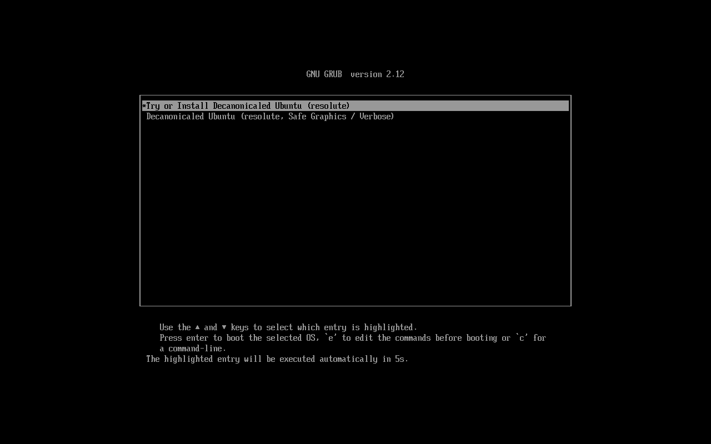
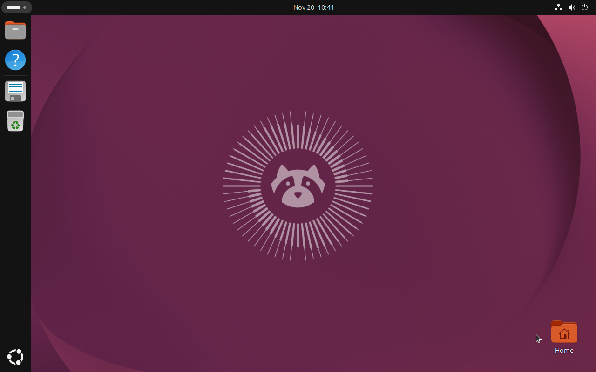

# DecanonicaledUbuntu

> *Note: This is a community-built, unofficial Ubuntu-based build pipeline provided as-is without warranty. Always verify `SHA256SUMS` and test in a VM before installing on your main machine. Not affiliated with or endorsed by Canonical Ltd. or Ubuntu.*

A `buildd`-style **GitHub Actions Build Farm** + **Sharded GitHub Releases APT Repository** that compiles Ubuntu 26.04 LTS (`resolute`) source packages into `.deb` binaries, bakes them into a clean, snap-free, telemetry-free bootable Ubuntu ISO, automatically boot-tests every ISO in QEMU (BIOS & UEFI), and keeps installed machines updated daily via `apt upgrade`.

## Screenshots

| GRUB2 Boot Menu (UEFI & BIOS) | Ubuntu 26.04 (`resolute`) GNOME Desktop |
|---|---|
|  |  |

## What Gets Removed & Replaced

### Removed
- **Snaps:** Purges `snapd`, `gnome-software-plugin-snap`, `libsnapd-glib*`, deletes `/snap` and `/var/lib/snapd`, and pins `snapd` at `-10` ([`nosnap.pref`](config/includes.chroot/etc/apt/preferences.d/nosnap.pref)) so APT never reinstalls it.
- **Telemetry & Crash Reporting:** Purges `ubuntu-report`, `popularity-contest`, `whoopsie`, `apport*`, and `kerneloops`; disables `motd-news` (`ENABLED=0` + masked service/timer); sets GNOME privacy dconf defaults (`report-technical-problems=false`, `send-software-usage-stats=false`).
- **Ubuntu Pro / Advantage:** Purges `ubuntu-advantage-tools` and `ubuntu-pro-client`.
- **Pre-installed Bloat:** Purges `gnome-tour`, `ubuntu-web-launchers`, pre-installed games (`aisleriot`, `gnome-mahjongg`, `gnome-mines`, `gnome-sudoku`), `rhythmbox`, `totem`, and `thunderbird`.

### Moved / Replaced
- **Firefox:** Replaced Ubuntu's snap stub with Mozilla's native `.deb` from `packages.mozilla.org`.
- **Installer:** Replaced Canonical's snap-based installer with **Calamares** (`calamares`).
- **APT Updates:** Configured `/etc/apt/sources.list.d/decanonicaled.list` to pull daily farm-compiled updates from your GPG-signed, sharded GitHub Releases (`apt-pool-<codename>-*`), while keeping `ubuntu-drivers-common` and `dkms` intact for hardware/GPU drivers.

## Just Goals

- **Actually knowing what is running on your system:** Compiling your own OS means you can see and verify what is actually running on your machine (every farm-built package is tagged `+decanonicaled1`, so you can check with `dpkg-query -W | grep -v '+decanonicaled'`).
- **Preventing build-time injection:** Compiling directly from inspectable source code (`apt-get source`) on transparent GitHub Actions runners avoids blindly trusting pre-built third-party binaries and reduces the risk of build-time supply-chain injection.

## Downloads & Builds

- **GitHub Actions (Workflows & ISO Artifacts):** https://github.com/arnnis/DecanonicaledUbuntu/actions
- **Latest `full` Scope ISO Build (`resolute` / `gnome-minimal`):** https://github.com/arnnis/DecanonicaledUbuntu/actions/runs/44147092742
  *(Download the `decanonicaled-ubuntu-resolute-gnome-minimal-full` `.zip` artifact and extract the `.iso` + `SHA256SUMS`. Note: GitHub Actions artifacts expire after 14 days; trigger a workflow run or push a `v*` tag for permanent GitHub Releases.)*
- **GitHub Releases (Sharded APT Pool & Tagged ISO Releases):** https://github.com/arnnis/DecanonicaledUbuntu/releases

## Architecture

1. **`plan-farm`** ([`scripts/resolve-sources.sh`](scripts/resolve-sources.sh)) — Resolves `core` ([`core.txt`](config/source-packages/core.txt)) or `full` inside an `ubuntu:<codename>` container using `apt-get install --simulate --install-recommends`, splitting heavy builds (`linux`, `gcc-*`, `llvm-*`, `mesa`, `webkit2gtk`, etc.) into solo runners across up to **60 farm workers** (20 concurrent).
2. **`build-farm`** ([`scripts/build-package.sh`](scripts/build-package.sh)) — Each worker compiles inside an isolated `ubuntu:<codename>` container (`apt-get source` → `apt-get build-dep` → `dpkg-buildpackage` + `ccache`), skipping `-dev`/`-doc`/`-dbg`/`-dbgsym` packages.
3. **Sharded GitHub Releases APT Repo** ([`scripts/publish-release-shards.sh`](scripts/publish-release-shards.sh)) — Chunks `.deb`s into numbered GitHub Releases (`max 800 .deb`s per release), sanitizes filenames, and signs `Release.gpg` / `InRelease` with GPG.
4. **ISO Assembly** ([`scripts/build-iso.sh`](scripts/build-iso.sh)) — Upgrades the `live-build` chroot from farm-compiled `.deb`s, runs de-bloating hooks, and packs a BIOS + UEFI hybrid ISO using `grub-mkrescue`.
5. **QEMU Boot Test** ([`build-iso.yml`](.github/workflows/build-iso.yml) & [`test-iso.yml`](.github/workflows/test-iso.yml)) — Automatically boots every built ISO in QEMU (BIOS & UEFI) and uploads boot screenshots.
6. **Daily Incremental Updates** ([`update-apt-repo.yml`](.github/workflows/update-apt-repo.yml)) — Runs daily at `02:00 UTC` and recompiles only packages with newer upstream `-security` / `-updates` versions.

## One-Time Setup on GitHub

1. **Create a persistent GPG signing key** (so installed systems trust future daily updates):
   ```bash
   gpg --batch --passphrase "" --quick-generate-key "DecanonicaledUbuntu APT <apt@example.com>" rsa4096 sign 5y
   gpg --armor --export-secret-keys "DecanonicaledUbuntu APT" | base64 -w0
   ```
   Add the base64 output as a repository secret named **`APT_GPG_PRIVATE_KEY`** (in **Settings → Secrets and variables → Actions**). *(If omitted, an ephemeral key is generated per run.)*
2. **Run** **Actions → Build Decanonicaled Ubuntu ISO (Build Farm) → Run workflow**.

## License

Licensed under the [MIT License](LICENSE).
